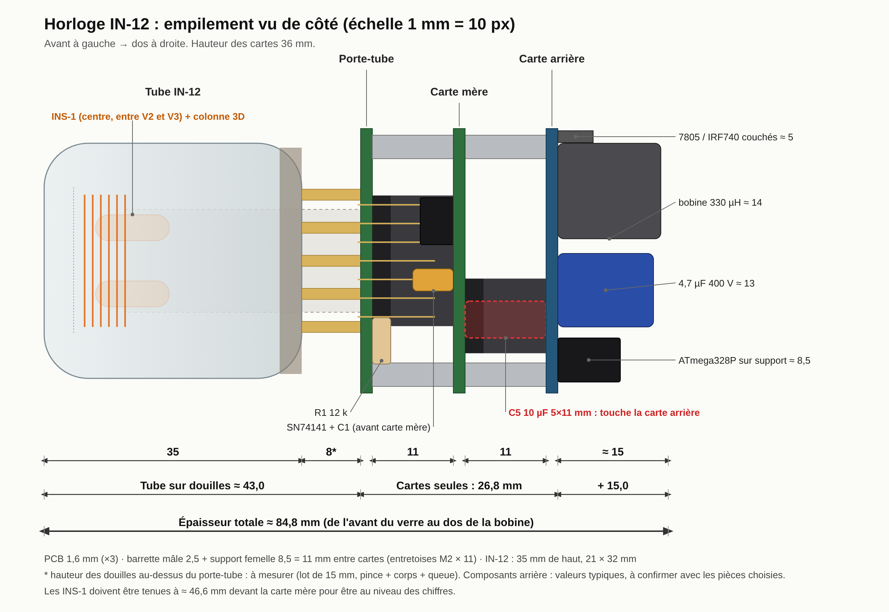

# Horloge nixie IN-12

Afficheur 4 chiffres à tubes nixie **IN-12A / IN-12B**, avec deux points en néons **INS-1**.
Un décodeur **SN74141 / K155ID1** par tube (pilotage statique). Chaque tube est monté sur son propre porte-tube, enfiché sur la carte mère.
Deux cartes empilées derrière la carte mère remplacent l'Arduino Uno et le module HT (tout en traversant) : une carte logique (ATmega328P, 74HC595, horloge DS1307) et une carte alimentation (12 V, 5 V, 170 V intégré, boutons).

L'image montre une seule carte arrière : avec deux cartes, compter ≈ 13 mm de plus (≈ 98 mm au total).

## Contenu

| Dossier | Contenu | État |
|---|---|---|
| `porte_tube_in12/` | Porte-tube individuel 25,4 × 36 mm, tube sur 12 douilles Ø 1 mm, R d'anode 12 kΩ | v1.0 terminé |
| `porte_tube_in12/fabrication/` | Gerbers + perçages prêts pour JLCPCB | à jour avec v1.0 |
| `carte_mere_in12/` | Carte mère 114,3 × 36 mm : 4 supports de porte-tubes, 4 × SN74141, 2 néons INS-1, connecteurs | schéma v0.3, routage en cours |
| `carte_mere_in12/docs/` | Schéma de la carte mère en PDF | v0.3 |
| `carte_logique_in12/` | Carte logique 114,3 × 36 mm, contre la carte mère : ATmega328P, 2 × 74HC595, DS1307, pilotage des deux points | schéma v0.1, composants placés, à router |
| `carte_alim_in12/` | Carte alimentation 114,3 × 36 mm, à l'arrière : jack 12 V, 5 V (L7805), 170 V (MC34063A + IRF740), coupure HT, boutons, ICSP, FTDI, pile CR1220 | schéma v0.1, composants placés, à router |
| `carte_*_in12/docs/` | Schémas en PDF et vues de placement | v0.1 |
| `firmware/nixie_in12/` | Programme Arduino pour le montage avec un Uno (horloge, affichage d'un nombre, anti-empoisonnement) | fonctionnel, à réécrire pour les nouvelles cartes |
| `docs/` | Vue de côté de l'empilement (≈ 27 mm de cartes, ≈ 85 mm avec tubes) | |

Projets KiCad 10. Les symboles et empreintes sont dans chaque dossier de projet (`*.kicad_sym`, `*.pretty`) : rien à installer.

## Carte mère : connecteurs

| Réf. | Rôle | Broches |
|---|---|---|
| J1–J8 | Supports des porte-tubes (gauche / droite de V1…V4) | gauche : K5 K4 K3 K2 K1 virgule – ; droite : K6 K7 K8 K9 K0 (clé) **+HT** |
| J9 | Commande V1, V2 (2×4, au dos) | 1-4 : V1 A B C D · 5-8 : V2 A B C D |
| J12 | Commande V3, V4 (2×4, au dos) | 1-4 : V3 A B C D · 5-8 : V4 A B C D |
| J10 | Logique (au dos) | 1 : +5 V · 2 : GND |
| J11 | Haute tension (au dos) | 1 : **+HT 170 V** · 2 : clé · 3 : GND |
| J13 | Deux points (au dos) | 1 : DOT1_A · 3 : DOT2_A · 5 : DOT_K (2 et 4 sans broche) |
| DS1, DS2 | Néons INS-1 dans l'espace central entre V2 et V3 | 1 : anode · 2 : cathode |

Empilement (entretoises M2 × 11 entre chaque carte, mêmes 16 trous) :
carte mère → **carte logique** (supports P1 à P5 sur J9, J12, J10, J11, J13) → **carte alimentation** (JB1 2 × 10 sur JA1, JB2 1 × 3 +HT sur JA2).

Liaison JA1/JB1 : 1 +5V · 2 GND · 3 RESET · 4 DTR · 5 MOSI · 6 MISO · 7 SCK · 8 RXD · 9 TXD · 10 HV_EN · 11 BTN_MODE · 12 BTN_PLUS · 13 BTN_MINUS · 14 LDR · 15 +5V · 16 GND · 17 +5V · 18 GND · 19 VBAT · 20 GND.
Liaison JA2/JB2 : 1 +HT · 2 sans broche · 3 GND.

Câblage vers l'Uno attendu par le programme (`BCD_PIN`) :

| Tube | A | B | C | D |
|---|---|---|---|---|
| V1 (J9 1-4) | D13 | D11 | D10 | D12 |
| V2 (J9 5-8) | D9 | D7 | D6 | D8 |
| V3 (J12 1-4) | D5 | D3 | D2 | D4 |
| V4 (J12 5-8) | A3 | A1 | A0 | A2 |

Masse commune entre l'Arduino, la carte mère et le module HT.

## Programme

Moniteur série 9600 bauds, fin de ligne « Nouvelle ligne » :
`T1435` règle l'heure à 14:35 · `N42` affiche 42 · `H` retour à l'horloge · `C` défilement anti-empoisonnement.

## Reste à faire

- Carte mère : relier le +5 V entre V1, V2 et V3, et la masse de C1 ; placer et router DS1, DS2, J13 ; DRC à 0 avant commande.
- Cartes logique et alimentation : router les PCB (composants déjà placés), puis réécrire le firmware (74HC595, DS1307, boutons, coupure HT, deux points).
- Mesurer le diamètre de la queue des douilles (perçage prévu pour 0,5–0,75 mm).
- Vérifier le brochage sur un vrai tube avant de souder (anode = broche 1).
- Option : points de séparation INS-1 dans l'espace central de la carte mère.

## Sécurité

170 V continu sur les porte-tubes et J11. Débrancher l'alimentation et attendre que la sortie HT soit sous 10 V avant de toucher la carte.

## Travailler sur deux PC

Un seul PC à la fois sur un même projet : **Fetch/Pull** avant d'ouvrir KiCad, **Commit + Push** après l'avoir fermé.

## Licence

[CC BY-NC-SA 4.0](LICENSE) : fabrication et modifications libres pour un usage personnel, en citant l'auteur. **Vente et usage commercial interdits** sans accord écrit. Les versions modifiées doivent être publiées sous la même licence.
Quelques empreintes et symboles viennent des bibliothèques KiCad et restent sous CC-BY-SA 4.0 : voir [LICENCES.md](LICENCES.md).

Projet fourni sans garantie. Il utilise une haute tension de 170 V : si vous le reproduisez, c'est à vos risques.
